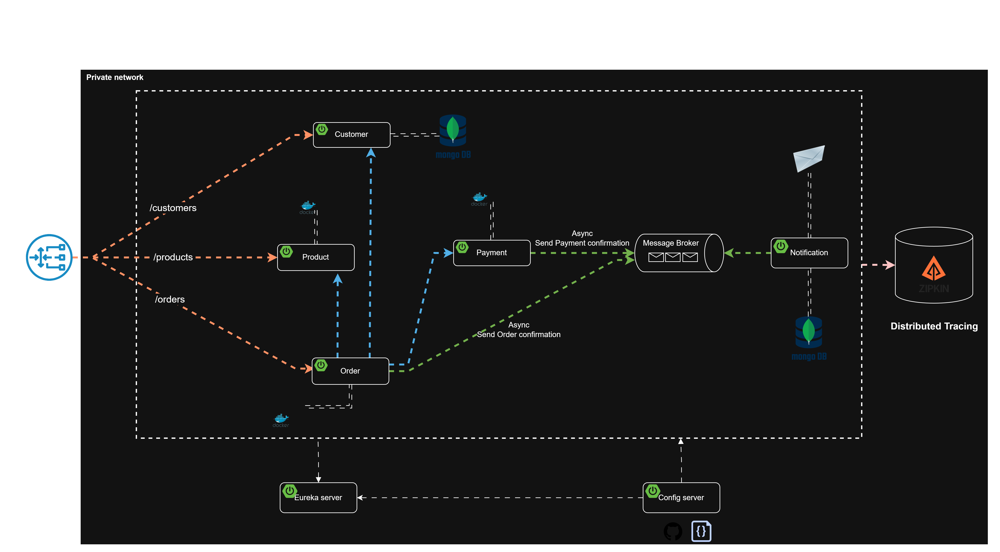

# E-Commerce Microservices

A Spring Boot microservice application built for learning. Services are discovered through Eureka, configured centrally by Spring Cloud Config, and exposed through a Spring Cloud Gateway. Order and payment events are sent over Kafka, and the notification service sends the resulting emails.

## Architecture


| Service | Port | Storage | Role |
|---|---|---|---|
| config-server | 8888 | - | Central configuration (`services/config-server/src/main/resources/configurations`) |
| discovery | 8761 | - | Eureka service registry |
| gateway | 8222 | - | API gateway, routes `/api/v1/**` to services |
| customer | 8090 | MongoDB (`customer`) | Customer management |
| product | 8050 | PostgreSQL (`product`) | Product catalogue and stock (Flyway migrations) |
| order | 8070 | PostgreSQL (`order`) | Orders and order lines; publishes order confirmations to Kafka |
| payment | 8060 | PostgreSQL (`payment`) | Payments; publishes payment confirmations to Kafka |
| notification | 8040 | MongoDB (`notification`) | Consumes Kafka events and sends emails |

Diagrams are in `diagrams/micro-services.drawio`. Design notes are in `resources/`.

### Gateway routes

| Path | Service |
|---|---|
| `/api/v1/customers/**` | customer |
| `/api/v1/products/**` | product |
| `/api/v1/orders/**`, `/api/v1/order-lines/**` | order |
| `/api/v1/payments/**` | payment |

## Prerequisites

- JDK 17
- Docker Desktop (with Docker Compose)
- Maven is optional because each service ships with `mvnw`

## Infrastructure

Start the supporting containers from the repo root:

```bash
docker compose up -d
```

| Container | Port | Purpose |
|---|---|---|
| PostgreSQL | 5432 | Product, order and payment data (user/password: `vijay`) |
| pgAdmin | 5050 | PostgreSQL UI (`pgadmin4@pgadmin.org` / `admin`) |
| MongoDB | 27017 | Customer and notification data (user/password: `vijay`) |
| Mongo Express | 8081 | MongoDB UI |
| Kafka (KRaft, no Zookeeper) | 9092 | Event messaging |
| Zipkin | 9411 | Distributed tracing |
| MailDev | 1080 (UI), 1025 (SMTP) | Catches emails sent by the notification service |

The PostgreSQL container does not create the databases. Create `product`, `order` and `payment` before starting those services, for example in pgAdmin at http://localhost:5050 or with:

```bash
docker exec -it ms_pg_sql psql -U vijay -c "CREATE DATABASE product;"
docker exec -it ms_pg_sql psql -U vijay -c "CREATE DATABASE \"order\";"
docker exec -it ms_pg_sql psql -U vijay -c "CREATE DATABASE payment;"
```

## Running the services

Start each service from its own folder in its own terminal, in this order:

1. `config-server`
2. `discovery`
3. `customer`, `product`, `order`, `payment` and `notification`, in any order
4. `gateway`

```bash
cd services/<service>
./mvnw spring-boot:run        # Windows PowerShell: .\mvnw spring-boot:run
```

You can also open the project in IntelliJ IDEA and run each service's main class.

## Checking that it works

- Eureka dashboard: http://localhost:8761, where all services should be registered
- Zipkin: http://localhost:9411
- MailDev: http://localhost:1080, where order and payment emails appear
- API entry point: `http://localhost:8222/api/v1/...`

Example flow:

1. `POST /api/v1/customers` creates a customer.
2. `POST /api/v1/products` creates a product.
3. `POST /api/v1/orders` places an order. This checks the customer, reserves stock, takes payment and publishes Kafka events, and the confirmation emails show up in MailDev.

## Stopping

```bash
docker compose down        # add -v to also delete the stored data
```

## Testing the APIs

- **Swagger UI (all services):** http://localhost:8222/swagger-ui.html. Use the dropdown at the top to switch between customer, product, order and payment.
- **Per-service Swagger UI:** http://localhost:8090/swagger-ui.html (customer), 8050 (product), 8070 (order), 8060 (payment).
- **Ready-made requests:** [api-tests.http](api-tests.http) works with the IntelliJ HTTP client or the VS Code "REST Client" extension.

### API list (through the gateway, port 8222)

| Method | Path | Description |
|---|---|---|
| POST | `/api/v1/customers` | Create customer (returns id) |
| PUT | `/api/v1/customers` | Update customer |
| GET | `/api/v1/customers` | List customers |
| GET | `/api/v1/customers/{id}` | Get customer |
| GET | `/api/v1/customers/exists/{id}` | Check that a customer exists |
| DELETE | `/api/v1/customers/{id}` | Delete customer |
| PUT | `/api/v1/products` | Create product |
| POST | `/api/v1/products/purchase` | Purchase products (reduces stock) |
| GET | `/api/v1/products` | List products |
| GET | `/api/v1/products/{id}` | Get product |
| POST | `/api/v1/orders` | Create order (calls customer, product and payment, publishes a Kafka event) |
| GET | `/api/v1/orders` | List orders |
| GET | `/api/v1/orders/{id}` | Get order |
| GET | `/api/v1/order-lines/order/{orderId}` | Order lines of an order |
| POST | `/api/v1/payments` | Create payment |
